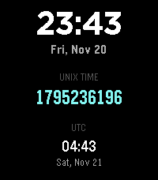

# Server Time

A phosphor-terminal watchface for the Pebble Time 2 (emery platform). Local
time and date up top, a live Unix epoch counter in the middle, and UTC time
and date at the bottom — all in Terminus on a black screen, like a good
green-phosphor terminal.



## Features

- Local time and date (`YYYY-MM-DD`) with seconds
- Unix epoch seconds, ticking every second
- UTC time and date, always 24-hour
- True monospace rendering (bundled Terminus font), so digits never shift
  as they tick
- Subtle CRT bloom on the bright text and a green-tinted backlight while
  the face is foregrounded

## Build and install

```sh
pebble build
pebble install --emulator emery   # test in the emulator
pebble install --cloudpebble      # install to a watch
```

## Project structure

| Path | Contents |
|---|---|
| `src/c/main.c` | The entire watchface |
| `resources/fonts/` | Bundled Terminus TTFs and their license |
| `package.json` | App metadata |
| `wscript` | Build configuration |

## License

The code is released under the [MIT License](LICENSE) — Copyright (c) 2026
Ben Mendis.

The bundled [Terminus TTF](https://files.ax86.net/terminus-ttf/) fonts are
Copyright (c) 2010 Dimitar Toshkov Zhekov and (c) 2011–2023 Tilman
Blumenbach, licensed under the [SIL Open Font License 1.1](resources/fonts/OFL.txt).
